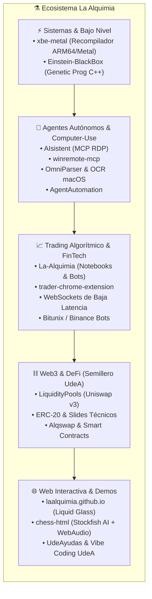

# 
🧪 La Alquimia ⚗️

  <em>« Ora, Lege, Lege, Lege, Relege, Labora et Invenies »</em> 
  <strong>Poder sobre el poder. Ecosistema de Sistemas de Bajo Nivel, Agentes Autónomos, Trading Algorítmico y Web3.</strong>

  
  
  

  
  
  
  
  
  
  

---

## 🧭 ¿Qué hacemos en La Alquimia?

**La Alquimia** es un laboratorio de ingeniería de software e investigación aplicada donde transformamos conceptos complejos de computación, inteligencia artificial y finanzas en herramientas pragmáticas, reproducibles y de alto rendimiento.

Nuestras líneas maestras de trabajo son:

1. 🤖 **Agentes Autónomos & Computer-Use**: Automatización profunda del sistema operativo vía MCP (*Model Context Protocol*), visión por computador (YOLO, Apple Vision nativo) y control inteligente de interfaces.
2. ⚡ **Sistemas de Bajo Nivel & Emulación**: Recompilación estática *bare-metal* para binarios legacy hacia Apple Silicon (ARM64/Metal) y WebGPU/Wasm, así como algoritmos de programación genética en C++.
3. 📈 **Trading Algorítmico & Cuantitativo**: Modelos matemáticos de análisis técnico, streaming de datos con WebSockets de baja latencia, extensiones de control operativo y bots para Binance, Bybit y Bitunix.
4. ⛓️ **Blockchain & Finanzas Descentralizadas (DeFi)**: Investigación en creación de mercado (AMMs / Uniswap v3), estándares de tokens (ERC-20), investigación formativa en el **Semillero de Blockchain de la Universidad de Antioquia (UdeA)** y smart contracts.
5. 🌐 **Experiencias Web Interactivas**: Aplicaciones frontend modernas con estética *Liquid Glass*, motores de IA en el navegador (Stockfish) y síntesis de audio procedural.

---

## 🗺️ Mapa del Ecosistema

---

## 🗂️ Directorio de Proyectos y Repositorios

### 1. 🤖 Agentes Autónomos, Computer-Use & Protocolo MCP
Sistemas que permiten a modelos multimodales interactuar directamente con interfaces de usuario y sistemas operativos:

| Proyecto | Descripción Intuitiva | Tecnologías |
| :--- | :--- | :--- |
| **[AIsistent](https://github.com/LaAlquimia/AIsistent)** | Servidor MCP para automatización remota de escritorios vía RDP con visión multimodal. Integra OCR nativo (Apple Vision / EasyOCR), detección de botones mediante YOLO (CUDA/MPS) e inyección de eventos con *huella cero* en la máquina remota. | Python, YOLO, Apple Silicon MPS, FastMCP |
| **[winremote-mcp](https://github.com/LaAlquimia/winremote-mcp)** | Servidor MCP con más de 40 herramientas para control de procesos, automatización de escritorio y manipulación remota de archivos en Windows. | Python, FastMCP |
| **[OCR_macOS](https://github.com/LaAlquimia/OCR_macOS)** | Pipeline de OCR ultrarrápido basado en la API nativa de Apple Vision para Apple Silicon (M-series), optimizado para agentes de Computer-Use. | Python, PyObjC, Vision API |
| **[OmniParser-MacOS](https://github.com/LaAlquimia/OmniParser-MacOS)** | Detección de elementos interactivos en pantalla optimizada para flujos de trabajo sobre macOS. | Jupyter Notebook, PyTorch |
| **[AgentAutomation](https://github.com/LaAlquimia/AgentAutomation)** | Orquestación agéntica y automatización avanzada dentro del ecosistema de desarrollo de La Alquimia. | TypeScript, HTML |

---

### 2. ⚡ Sistemas de Bajo Nivel, Compiladores & Modelado Matemático
Ingeniería de software cercana al hardware, emulación y computación evolutiva:

| Proyecto | Descripción Intuitiva | Tecnologías |
| :--- | :--- | :--- |
| **[xbe-metal](https://github.com/LaAlquimia/xbe-metal)** | Recompilador estático *bare-metal* y runtime multiplataforma para binarios `.xbe` targeting macOS (ARM64 nativo vía Metal) y WebAssembly (WebGPU). | C++, Metal, WebGPU, CMake |
| **[Einstein-BlackBox](https://github.com/LaAlquimia/Einstein-BlackBox)** | Motor en C++ de Programación Genética Lineal y Completa para inferir formulaciones matemáticas y leyes a partir de series de datos físicos. | C++, Algoritmos Genéticos |

---

### 3. 📈 Trading Algorítmico, FinTech & Herramientas Cuantitativas
Automatización de operaciones en exchanges, análisis de liquidez y monitoreo de mercado:

| Proyecto | Descripción Intuitiva | Tecnologías |
| :--- | :--- | :--- |
| **[La-Alquimia](https://github.com/LaAlquimia/La-Alquimia)** | Repositorio central de notebooks, bots de ejecución y modelos de análisis técnico cuantitativo (SMA, EMA, RSI, volumen) para Binance y Bybit. | Python, Pandas, Matplotlib, Jupyter |
| **[trader-chrome-extension](https://github.com/LaAlquimia/trader-chrome-extension)** | Extensión de navegador para ejecución instantánea de órdenes y gestión de riesgo (SL/TP) en terminales de trading (Bybit / Binance). | JavaScript, Web Extensions API |
| **[la-alquimia-bitunix-trading-bot](https://github.com/LaAlquimia/la-alquimia-bitunix-trading-bot)** | Bot de trading algorítmico automatizado con gestión de órdenes sobre el exchange Bitunix. | Python, REST API |
| **[websockets-alquimia](https://github.com/LaAlquimia/websockets-alquimia)** | Transmisión y captura de libro de órdenes en tiempo real con WebSockets de baja latencia. | Python, WebSockets |
| **[Market-Maker-Bot](https://github.com/LaAlquimia/Market-Maker-Bot)** / **[UniswapMM_Bot](https://github.com/LaAlquimia/UniswapMM_Bot)** | Algoritmos de provisión y rebalanceo de liquidez automatizada en piscinas Uniswap. | JavaScript, Node.js |
| **[Script-Gafas-Trading-](https://github.com/LaAlquimia/Script-Gafas-Trading-)** | Filtro de divergencias para detección de patrones de carga y descarga ("LCD") en futuros de Binance. | Python |

---

### 4. ⛓️ Blockchain, Smart Contracts & Semillero UdeA
Investigación formativa y desarrollo sobre protocolos Web3:

| Proyecto | Descripción Intuitiva | Tecnologías |
| :--- | :--- | :--- |
| **[LiquidityPools](https://github.com/LaAlquimia/LiquidityPools)** | Recurso pedagógico e interactivo sobre piscinas de liquidez, curvas de formación de precios y liquidez concentrada en Uniswap v3 (Semillero Blockchain UdeA). | HTML5, MathJax, SVG |
| **[ERC20](https://github.com/LaAlquimia/ERC20)** | Investigación técnica y presentación interactiva del estándar ERC-20, mecanismos de aprobación y vectores de ataque comunes. | HTML5, JavaScript |
| **[diapositivas-blockchain](https://github.com/LaAlquimia/diapositivas-blockchain)** | Diapositivas dinámicas para el aprendizaje universitario sobre criptografía de clave pública, bloques y consenso distribuido. | HTML5, CSS3 |
| **[Alqswap](https://github.com/LaAlquimia/Alqswap)** & **[leverage-contracts](https://github.com/LaAlquimia/leverage-contracts)** | Smart contracts de swap descentralizado y protocolos de apalancamiento en EVM. | Solidity, Hardhat |

---

### 5. 🌐 Interfaces Web, Experiencias Interactivas & Demos
Plataformas web modernas, diseño y desarrollo interactivo:

| Proyecto | Descripción Intuitiva | Tecnologías |
| :--- | :--- | :--- |
| **[laalquimia.github.io](https://github.com/LaAlquimia/laalquimia.github.io)** | Sitio web oficial del ecosistema con estética de cristal líquido (*Liquid Glass*), translucidez y resplandores en verde esmeralda y cian. | Astro, Svelte, Tailwind CSS |
| **[chess-html](https://github.com/LaAlquimia/chess-html)** | Aplicación web de ajedrez responsiva con motor Stockfish AI, personalización de tableros y efectos de sonido procedurales ([Probar en vivo](https://laalquimia.github.io/chess/)). | HTML5, JavaScript, WebAudio |
| **[UdeAyudas](https://github.com/LaAlquimia/UdeAyudas)** / **[Hackaton](https://github.com/LaAlquimia/Hackaton)** | Proyectos desarrollados en hackathons orientados a herramientas agénticas de asistencia para estudiantes universitarios. | Astro, TypeScript |
| **[vibe-coding-udea](https://github.com/LaAlquimia/vibe-coding-udea)** | Talleres y recursos sobre programación colaborativa impulsada por IA en la Universidad de Antioquia. | Markdown, Colab |

---

## 🏛️ Filosofía y Comunidad

> *"Poder sobre el poder. Solo nos falta seguir trabajando..."*

- 🌐 **Web:** [laalquimia.github.io](https://laalquimia.github.io)
- 🐙 **GitHub:** [@LaAlquimia](https://github.com/LaAlquimia)
- 📍 **Medellín, Colombia** — Universidad de Antioquia (UdeA)

---

  © La Alquimia — Desarrollado con pasión por la investigación, la ingeniería y el código libre.

